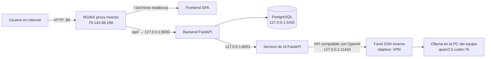

# Arquitectura de red y proxy inverso

AdaptMobile se despliega en un servidor Ubuntu en la nube (IP pública `79.143.88.199`).
**Solo el puerto 80 (NGINX) y el 22 (SSH) escuchan hacia internet.** El backend, el
servicio de IA y la base de datos escuchan únicamente en `127.0.0.1`, y NGINX es la única
puerta de entrada.

## Diagrama



## Servicios y exposición

| Servicio | Puerto | Escucha en | ¿Público? |
|---|---|---|---|
| NGINX (frontend + proxy `/api/`) | 80 | 0.0.0.0 | Sí |
| SSH (administración) | 22 | 0.0.0.0 | Sí |
| Backend FastAPI | 8000 | 127.0.0.1 | No |
| Servicio de IA FastAPI | 8001 | 127.0.0.1 | No |
| PostgreSQL | 5432 | 127.0.0.1 | No |
| Ollama (vía túnel SSH) | 11434 | 127.0.0.1 | No |

## Configuración del proxy inverso (NGINX)

Archivo en el servidor: `/etc/nginx/conf.d/adaptmobile.conf`

```nginx
server {
    listen 80 default_server;
    server_name _;

    root /opt/Los_Telefonos/AdaptMobile/web/src;
    index index.html;

    location /api/ {
        proxy_pass http://127.0.0.1:8000/api/;
        proxy_http_version 1.1;
        proxy_set_header Host $host;
        proxy_set_header X-Real-IP $remote_addr;
        proxy_set_header X-Forwarded-For $proxy_add_x_forwarded_for;
        proxy_set_header X-Forwarded-Proto $scheme;
        proxy_read_timeout 300s;
        client_max_body_size 20M;
    }

    location / {
        try_files $uri $uri/ /index.html;
    }
}
```

- `location /api/` envía las peticiones al backend interno; el navegador nunca habla con el puerto 8000.
- `proxy_read_timeout 300s` es necesario porque la IA local (Ollama en CPU) puede tardar minutos en responder.
- `client_max_body_size 20M` permite subir los archivos de proyecto a analizar.

## Cómo llega una petición de análisis

1. El usuario sube `package.json` (o `pubspec.yaml`, etc.) en `http://79.143.88.199`.
2. NGINX recibe `POST /api/analysis/upload` y lo reenvía al backend (`127.0.0.1:8000`).
3. El backend pide al servicio de IA (`127.0.0.1:8001`) que estime los requisitos de hardware.
4. El servicio de IA consulta a Ollama por el túnel (`127.0.0.1:11434`). Si Ollama no responde, usa un motor determinista de respaldo.
5. El backend cruza los requisitos con el catálogo de teléfonos en PostgreSQL y responde al usuario.

## Enlace con Ollama (estado actual)

Hoy el servidor llega a Ollama mediante un túnel SSH inverso desde la PC que lo ejecuta:

```bash
ssh -i ~/.ssh/LLAVE.pem -N -R 127.0.0.1:11434:localhost:11434 root@79.143.88.199
```

El objetivo de la práctica es sustituir ese túnel por la dirección del servidor Ollama dentro de la VPN
del equipo; solo cambia `DEEPSEEK_BASE_URL` en el servidor.

## Despliegue

El script `deploy/deploy_nativo.sh` instala PostgreSQL, NGINX y el entorno de Python, y crea los servicios
`adaptmobile-ai` y `adaptmobile-backend` con systemd (despliegue sin Docker por el poco espacio en disco del servidor).
